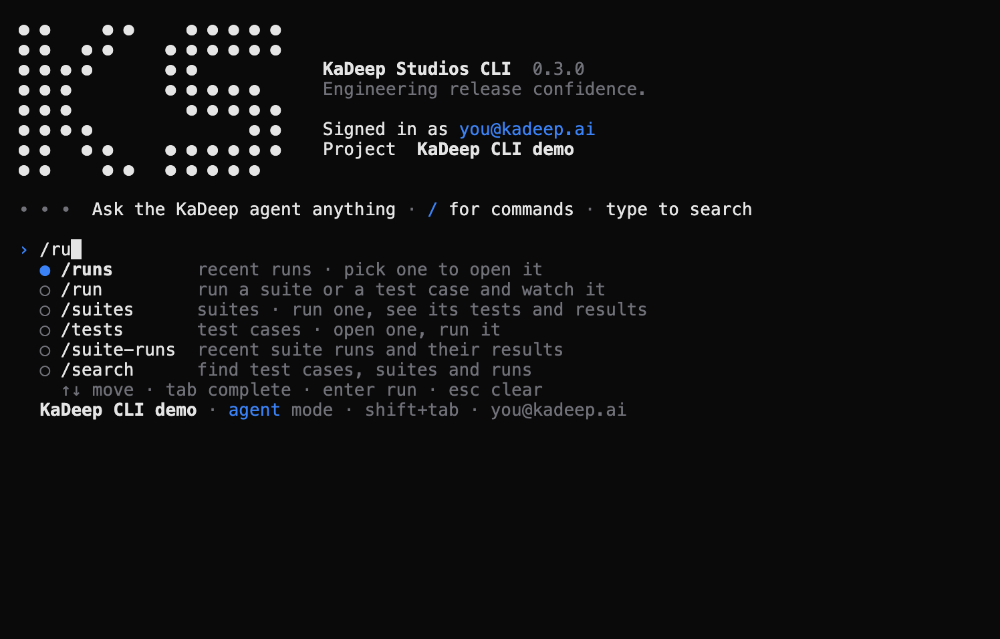
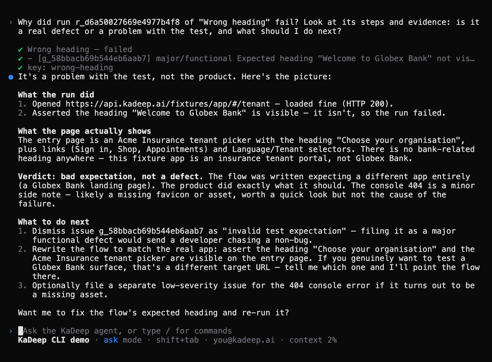
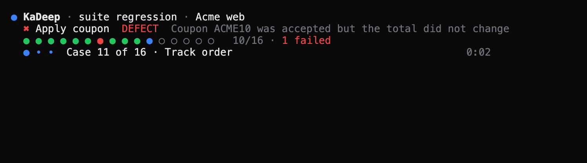
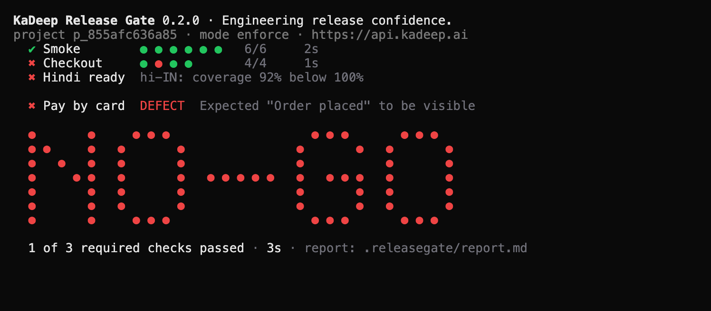
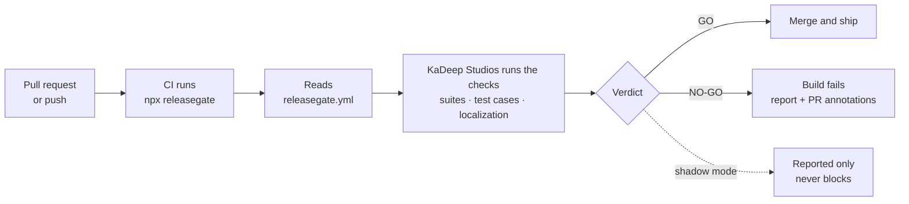
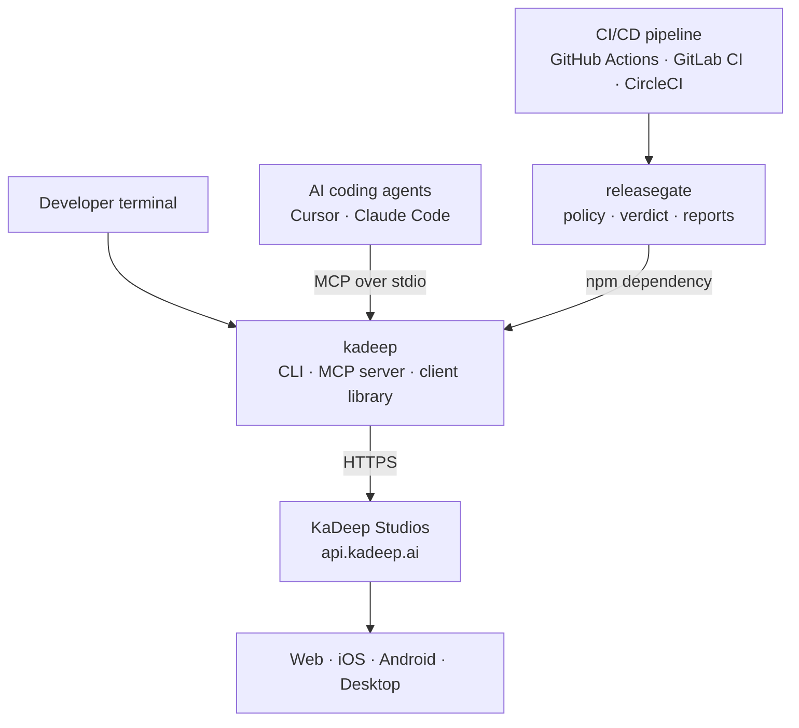
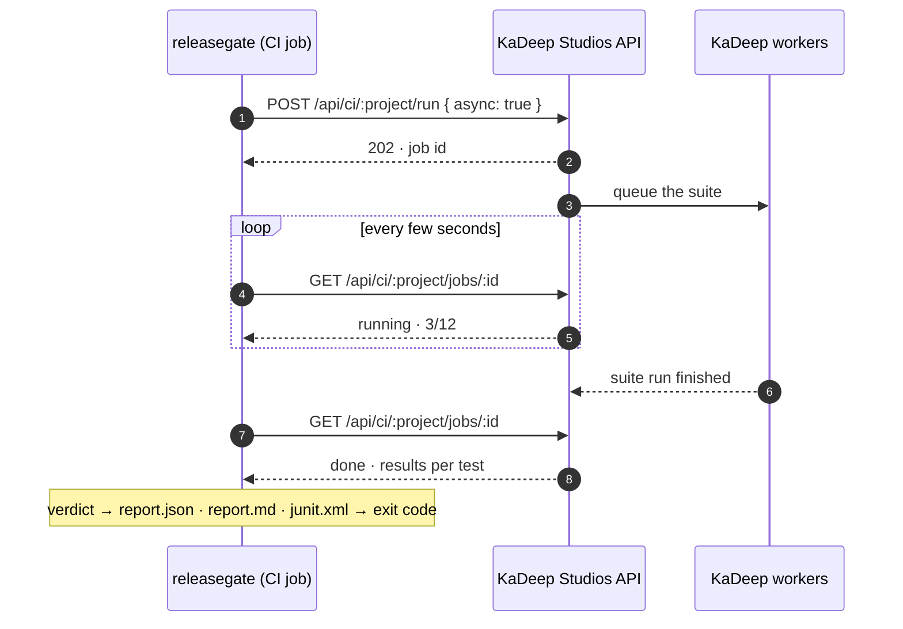

<p align="center">
  <a href="https://kadeep.ai"></a>
</p>

<h1 align="center">kadeep</h1>

<p align="center">
  <b>Your coding agent says "done". kadeep checks it actually works.</b><br>
  An AI QA engineer that tests any URL, localhost included, in a real browser on your machine,<br>and returns pass / fail with the bugs, console errors and failed requests your agent needs to fix them.
</p>

<p align="center"><i>Engineering release confidence.</i></p>

<p align="center">
  <a href="https://www.npmjs.com/package/kadeep"></a>
  <a href="https://www.npmjs.com/package/kadeep"></a>
  <a href="https://github.com/kadeep-ai/kadeep-cli/actions/workflows/ci.yml"></a>
  <a href="https://registry.modelcontextprotocol.io/v0.1/servers?search=io.github.kadeep-ai/kadeep"></a>
  <a href="https://skills.sh"></a>
  <a href="LICENSE"></a>
</p>

---

```sh
npx kadeep test http://localhost:3000 "sign up with a new email and reach the dashboard"
```

Example output, abridged:

```
  · 1 fill e4 "test+kadeep@example.com"
  · 2 fill e6 "correct-horse-9"
  · 3 click Create account
  ✗ 4 click Continue  Timeout 10000ms exceeded.

✗ FAIL  Sign-up submits, but the dashboard never loads: POST /api/onboarding returns 500 and the page stays on "Loading…".
  ✓ Sign-up form accepts a new email
  ✗ Dashboard loads after sign-up

1 bug
  ● [critical] Dashboard never loads after sign-up
      actual: Spinner forever; POST /api/onboarding → 500
      expected: Dashboard with the welcome card

4 actions · 48s · 1 console error, 1 failed request · evidence .kadeep/runs/2026-11-20_09-14-02-localhost-3000
```

- **Runs where your code runs.** Playwright on your machine, so it reaches `localhost`, preview URLs and staging behind a VPN. No deploy, no tunnel, no test files to write.
- **Built for coding agents.** `--json` gives one document with `verdict`, `bugs[]` (repro steps, expected, actual, screenshot), `console[]` and `network[]`. Exit codes are stable: 0 pass, 1 fail, 2 setup, 3 unreachable, 4 no verdict.
- **No sign-up to start.** Bring your own `ANTHROPIC_API_KEY`, or run `npx kadeep try` for a free anonymous trial.
- **Accessibility too.** `npx kadeep a11y <url>` is a deterministic WCAG 2.2 AA audit (axe-core): no model, no account.
- **Grows with you.** The same CLI runs saved suites in [KaDeep Studios](https://kadeep.ai) on web, iOS, Android and desktop, and `releasegate` turns them into a go / no-go gate on every PR.

## Give it to your coding agent

| Agent | One line |
| --- | --- |
| Any agent (Agent Skill) | `npx skills add kadeep-ai/kadeep-cli` |
| This repo, every agent | `npx kadeep init --agent` (skill + `AGENTS.md` + MCP config, no sign-in) |
| Claude Code (plugin) | `/plugin install kadeep --marketplace kadeep-ai/kadeep-cli` |
| Claude Code (MCP) | `claude mcp add kadeep -- npx -y kadeep mcp` |
| Codex CLI | `codex mcp add kadeep -- npx -y kadeep mcp` |
| Gemini CLI | `gemini mcp add kadeep npx -y kadeep mcp` |
| Cursor | [](https://cursor.com/en/install-mcp?name=kadeep&config=eyJjb21tYW5kIjoibnB4IiwiYXJncyI6WyIteSIsImthZGVlcCIsIm1jcCJdfQ%3D%3D) |
| VS Code | [Install in VS Code](https://insiders.vscode.dev/redirect/mcp/install?name=kadeep&config=%7B%22type%22%3A%22stdio%22%2C%22command%22%3A%22npx%22%2C%22args%22%3A%5B%22-y%22%2C%22kadeep%22%2C%22mcp%22%5D%7D) |

Then ask your agent to *"build the pricing page and check it works with kadeep"*. The skill tells it when to test (after UI changes, before saying done), how to write the goal, and how to read the result. MCP tools: `test_url`, `a11y_audit`, `start_trial`, plus the KaDeep Studios project tools.

## Contents

- [Quick start](#quick-start)
- [What it looks like](#what-it-looks-like)
- [Features](#features)
- [From commit to go / no-go](#from-commit-to-go--no-go)
- [How it works](#how-it-works)
- [Use cases](#use-cases)
- [Which package do I need?](#which-package-do-i-need)
- [Terminology](#terminology)
- [FAQ](#faq)
- [Contributing](#contributing)

## Quick start

You need **Node.js 20+**. Nothing else to install: the first `kadeep test` fetches Playwright once and uses your Chrome (or downloads Chromium).

```sh
# Test anything, right now (your key, or a free trial)
export ANTHROPIC_API_KEY=sk-ant-...            # or: npx kadeep try
npx kadeep test http://localhost:3000 "add two items to the cart and check the total"
npx kadeep test https://staging.example.com --viewport mobile     # no goal: explore and hunt for bugs
npx kadeep a11y http://localhost:3000/checkout                    # WCAG 2.2 AA, no model needed

# With a KaDeep Studios account (free: https://kadeep.ai/start)
npx kadeep                       # the interactive home: sign in, pick a project, ask the agent or type /
npx kadeep run --suite smoke     # run a saved suite in the cloud and wait for the verdict
npx kadeep init                  # add a releasegate policy + GitHub Actions workflow to this repo
```

After `kadeep init`, every pull request runs `npx releasegate` and gets a go / no-go:

```
KaDeep Release Gate 0.4.0 · Engineering release confidence.
project p_9a118f0499704752be72 · commit 8c3f2d1 on feature/checkout PR #214 · mode enforce
▸ Smoke
✓ Smoke: 12/12 passed (2m 41s)
▸ Checkout
✗ Checkout: 3/4 passed (1m 05s)
    ✗ Pay by card [DEFECT] · Expected "Order placed" to be visible

NO-GO · 1/2 required checks passed · 3m 47s
```

## What it looks like

A terminal UI built on the dot, like the KaDeep Studios logo: every test is a dot, and the release verdict is drawn in dots. It has no dependencies, and output stays plain in CI.

<table>
  <tr>
    <td></td>
    <td></td>
  </tr>
  <tr>
    <td></td>
    <td></td>
  </tr>
</table>

## Features

| You want to… | Command |
| --- | --- |
| Check a change works in a real browser, localhost included, no account | `kadeep test <url> "what to check"` |
| Audit accessibility (WCAG 2.2 AA) with no model and no account | `kadeep a11y <url>` |
| Let your agent start without a sign-up | `kadeep try` |
| Teach every coding agent in a repo to test its work | `kadeep init --agent` |
| Drive everything from one place in the terminal, like Claude Code | `kadeep` (the interactive home) |
| Ask the KaDeep agent why something failed, or have it act | Type the question in the home, or `kadeep ask "…"` |
| Run AI end-to-end tests from the terminal | `kadeep run --suite smoke` |
| Run specific test cases on another browser or screen size | `kadeep run --test checkout-works --browser firefox --viewport mobile` |
| See why a test failed, step by step | `/runs` in the home, then pick the run · `kadeep runs show <runId>` |
| Browse projects, suites, test cases and defects | `kadeep projects` · `kadeep suites` · `kadeep tests` · `kadeep issues` |
| Block a release when required checks fail | `npx releasegate` in CI |
| Try the gate first without blocking anyone | `mode: shadow` in `releasegate.yml` |
| Set up a repository (policy, CI workflow, agent config) in one step | `kadeep init` |
| Let Cursor or Claude Code run and read your tests | `kadeep mcp` (MCP server) |
| Check localization quality in CI | `kadeep loc validate` · a `localization` check in `releasegate.yml` |
| Script anything, parse the output | `--json` on every command, stable exit codes |
| Publish test results to CI dashboards | `kadeep run --junit results.xml` · `releasegate` writes `junit.xml` |
| Watch runs live in the terminal, plain in CI | Rich view in a terminal; `NO_COLOR`, `KADEEP_UI=plain` |

## From commit to go / no-go



- **GO**: every required check passed.
- **NO-GO**: a required check failed or errored. An empty suite is never a pass.
- **Shadow mode**: the verdict is reported but never fails the build, so you can watch the gate for a while before letting it block.

The report lands in `.releasegate/` (`report.json`, `report.md`, `junit.xml`). On GitHub it also goes into the job summary and annotates failing checks.

## How it works



- **`kadeep` is the foundation.** It contains the CLI, the MCP server and the client library: sign-in, runs, localization and CI detection. It has no runtime dependencies.
- **`releasegate` is built on `kadeep`.** It adds the policy file, the go / no-go decision, shadow mode and the reports. It depends on `kadeep`, never the reverse.
- **Two ways to run.** `kadeep test` and `kadeep a11y` run a browser on your machine (the runtime, Playwright and the Anthropic SDK, is installed on first use, so the core CLI stays dependency-free). `kadeep run` and `releasegate` run saved suites in KaDeep Studios. No telemetry either way.

Runs are **jobs on KaDeep's queue**. The CLI starts them and polls, so no request stays open while a suite runs. A long suite survives proxies with idle timeouts, and a CI network blip costs one retried poll:



## Use cases

### Run end-to-end tests from the terminal

```sh
kadeep use "Acme web"                        # default project
kadeep run --suite smoke                     # ✓ / ✗ per test, exit 1 if any fail
kadeep runs show r_bf6382d90aab              # every step, the verdict and why
kadeep run --suite regression --no-wait      # queue it, come back later
kadeep jobs show job_8ad6a6bb92 --wait
```

### Add a release gate to GitHub Actions

`kadeep init` generates `.github/workflows/releasegate.yml`. Its core:

```yaml
name: KaDeep Release Gate
on:
  pull_request:
  push:
    branches: [main]
jobs:
  releasegate:
    runs-on: ubuntu-latest
    steps:
      - uses: actions/checkout@v4
      - uses: actions/setup-node@v4
        with:
          node-version: 22
      - run: npx -y releasegate@^0.4
        env:
          KADEEP_CI_TOKEN: ${{ secrets.KADEEP_CI_TOKEN }}
```

The policy file sits next to it:

```yaml
# releasegate.yml
version: 1
project: p_9a118f0499704752be72
mode: shadow            # switch to enforce once you trust the verdicts
checks:
  - suite: smoke
  - tests: [checkout-works]
    viewport: mobile
  - localization:
      locales: [hi-IN, ar-AE]
```

GitLab CI, CircleCI, Bitbucket Pipelines, Buildkite, Azure Pipelines and Jenkins work the same way. See [releasegate: CI setup](packages/releasegate#ci-setup).

### Let AI coding agents run your QA (MCP)

```sh
claude mcp add kadeep -- npx -y kadeep mcp        # Claude Code
```

```json
{ "mcpServers": { "kadeep": { "command": "npx", "args": ["-y", "kadeep", "mcp"] } } }
```

That second snippet goes in Cursor's `.cursor/mcp.json`. Your agent can then answer "which smoke tests fail and why?" or "run the checkout tests" by itself. It gets 14 tools: projects, suites, test cases, runs, jobs, defects and the localization gate.

### Gate localization in CI

```sh
kadeep loc push --file locales/en.json --translate     # new source strings
kadeep loc validate --locale hi-IN --locale ar-AE      # exit 1 with the reasons
kadeep loc pull --asset en.json --locale hi-IN         # approved translations only
```

## Which package do I need?

| If you… | Use |
| --- | --- |
| work in a terminal or write scripts | `kadeep` |
| want Cursor, Claude Code or another MCP client to use KaDeep | `kadeep mcp` |
| want CI to pass or fail a build on KaDeep results, with a policy and reports | `releasegate` (it installs `kadeep` for you) |
| just want to run one suite in CI and fail on red | `kadeep run --project <id> --suite smoke` |

## Terminology

| Term | Meaning |
| --- | --- |
| **KaDeep Studios** | The QA platform and app where your projects, test cases and runs live |
| **KaDeep CLI** | This repository's command line, the `kadeep` package and command |
| **KaDeep Release Gate** | The CI gate, the `releasegate` package and command. Its policy file is `releasegate.yml` |
| **Test case** | One user journey KaDeep runs, e.g. *checkout works*. `kadeep tests` lists them; the API calls them *flows* |
| **Suite** | A named group of test cases, e.g. *smoke* |
| **Run** / **suite run** | One execution of a test case / of a suite, with a verdict and evidence |
| **Job** | A queued or running execution. The CLI follows jobs until they finish |
| **CI token** | A project's token for pipelines (`KADEEP_CI_TOKEN`), created with `kadeep ci-token create` |
| **GO / NO-GO** | The gate's verdict. **Shadow** mode reports it; **enforce** mode fails the build on NO-GO |

## FAQ

<details>
<summary><b>Do I need a KaDeep account?</b></summary>

No, not for `kadeep test` and `kadeep a11y`. They run on your machine. `kadeep test` needs a model: your own `ANTHROPIC_API_KEY` (or an `ant auth login` profile), or KaDeep's plan through a free anonymous trial (`kadeep try`) or an account. Saved suites, cloud devices (iOS, Android, desktop), scheduled runs, team memory and `releasegate` use KaDeep Studios.
</details>

<details>
<summary><b>How is this different from Playwright MCP or a browser tool?</b></summary>

Those give your agent hands: click, type, snapshot. Your agent then has to plan the test, judge the result and remember what it checked, inside its own context window. `kadeep test` hands the whole job to a separate QA agent and returns only the verdict and the evidence, so your coding agent stays focused on the code and gets a second opinion it did not write itself.
</details>

<details>
<summary><b>What does it cost?</b></summary>

The CLI is free and open source. On your own key, a typical `kadeep test` is a few cents to tens of cents of model usage (Claude Opus 5.5 by default; `--model` and `--effort` trade cost for depth). `kadeep a11y` uses no model at all.
</details>

<details>
<summary><b>What is a release gate?</b></summary>

A release gate is an automated check in your CI/CD pipeline that decides whether a change may ship. `releasegate` makes that decision from KaDeep Studios results for the exact commit under test: suites, test cases and localization. It returns GO or NO-GO, with a report of why.
</details>

<details>
<summary><b>Is KaDeep CLI free and open source?</b></summary>

Yes. `kadeep` and `releasegate` are open source under Apache-2.0. They connect to KaDeep Studios, where your tests run, and you can [get started for free](https://kadeep.ai/start).
</details>

<details>
<summary><b>Which CI/CD systems does releasegate support?</b></summary>

Any pipeline that can run Node.js 20. The commit, branch, PR number and run link are read automatically on GitHub Actions, GitLab CI, CircleCI, Bitbucket Pipelines, Buildkite, Azure Pipelines and Jenkins. Anywhere else, the gate falls back to `git`.
</details>

<details>
<summary><b>Does it work with Cursor, Claude Code and other AI agents?</b></summary>

Yes. `kadeep mcp` is a Model Context Protocol server over stdio. Any MCP client can list your tests, run them, wait for the verdict and read failures step by step.
</details>

<details>
<summary><b>What does the CLI send, and where are credentials stored?</b></summary>

It makes HTTPS calls to the KaDeep API you point it at (`https://api.kadeep.ai` by default) and, for `kadeep test` on your own key, to the Anthropic API. There is no telemetry. The page under test is only visited by the browser on your machine; its snapshots and screenshots go to the model you chose. Your session is stored in `~/.config/kadeep/config.json`, readable only by you. In CI, a per-project CI token is used instead of a personal login.
</details>

<details>
<summary><b>Can I try the gate without blocking my team?</b></summary>

Yes. Set `mode: shadow` in `releasegate.yml` (`kadeep init` starts there). The gate runs every check, writes the report and says "would have blocked", but always exits 0. Switch to `mode: enforce` when its verdicts match your judgement.
</details>

## Contributing

Issues and pull requests are welcome: see [CONTRIBUTING.md](CONTRIBUTING.md). Good first issues are labelled [`good first issue`](https://github.com/kadeep-ai/kadeep-cli/labels/good%20first%20issue). If kadeep caught a bug for you, a star helps other people find it.

## Development

```sh
git clone https://github.com/kadeep-ai/kadeep-cli.git && cd kadeep-cli
npm install
npm run ci            # typecheck (JSDoc + checkJs), tests on the local Node, tarball check
```

```
packages/
  kadeep/         CLI, MCP server and client library (no runtime dependencies)
  releasegate/    KaDeep Release Gate (depends on kadeep and yaml)
scripts/
  check-packs.mjs guards what npm publishes
```

- **Sources:** plain ES modules with JSDoc types. There is no build step, so what is in `packages/*/src` is what ships.
- **CI:** runs the tests on Node.js 20, 22 and 24.
- **Tarball check:** `scripts/check-packs.mjs` fails a publish if anything other than `bin/`, `src/`, `README.md` and `LICENSE` would ship, or if a file contains a secret or a source map.
- **Releases:** both packages share one version. Publish `kadeep` first, then `releasegate`.

Found a bug or have an idea? [Open an issue](https://github.com/kadeep-ai/kadeep-cli/issues).

## License

[Apache-2.0](LICENSE) © Kadeep Technologies. KaDeep Studios is a product of Kadeep Technologies ([kadeep.ai](https://kadeep.ai)).
